<div align="center">



<br/><br/>

<a href="https://zugolabs.com"></a>
<a href="mailto:ventas@zugolabs.com"></a>

</div>

<br/>

### `$ whoami`

Hola, soy **Jonathan Muñoz** 👋. Construyo software que mueve negocios desde **[ZuGo Labs](https://zugolabs.com)**: automatizaciones con IA, apps móviles y plataformas web pensadas para vender mejor, operar con claridad y ofrecer experiencias que se sienten bien.



### `$ cat stack.txt`

<p>
  
</p>

<a href="https://zugolabs.com"></a>

<details>
<summary><code>$ sudo cat /etc/secreto.txt</code></summary>
<br/>

```text
[sudo] contraseña para jonathan: ••••••••
acceso concedido.

🌵 supernopalito: espinoso por fuera, código limpio por dentro.
```

</details>

<br/>


